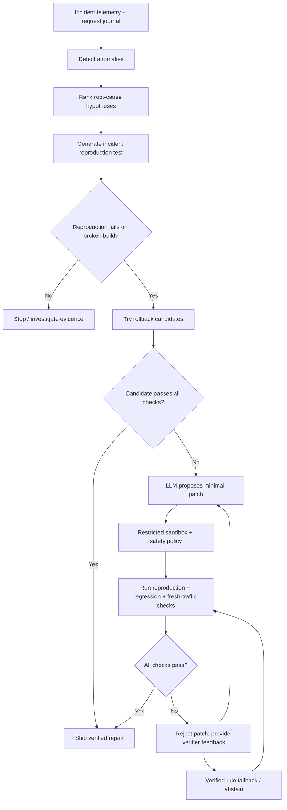

# OpsPilot AI — Verified Production Incident Repair

OpsPilot is a research/portfolio project that investigates simulated production incidents, reproduces failures, proposes repairs, and only ships a candidate when independent verification succeeds. It is designed around a simple principle: **a plausible patch is not a proven fix**.

> **Current v6 status:** The maintainer's local run reports **49/49 tests passing** and all six latent incident demos passing the verifier and hidden oracle. In those six Ollama demos, the final shipped repair was `verified-rule via rules`; the LLM's proposals were rejected. These are benchmark results, not evidence of production readiness or a guarantee on real incidents. See [`docs/V6_BENCHMARK_RESULTS.md`](docs/V6_BENCHMARK_RESULTS.md).

## Why this project is interesting

- **Reproduce before repairing:** the incident must be represented by a failing test.
- **Guardrails for model-generated edits:** strict edit parsing, file allowlists, and a restricted execution sandbox.
- **Three verification gates:** incident reproduction goes red → green, existing regression tests pass, and fresh traffic shows no detected anomalies.
- **Hidden-oracle evaluation:** the benchmark checks that repaired behavior matches a healthy build and that telemetry is anomaly-free on held-out traffic.
- **Safe fallback:** if proposed patches fail, OpsPilot can use a verified rule-based repair rather than shipping an unverified LLM patch.

## Architecture



The implementation is split across `opspilot/` (detection, investigation, reproduction, repair, sandbox, verification, evaluation) and `shop/` (the simulated service system). See [`docs/architecture.mmd`](docs/architecture.mmd) for the diagram source.

## Requirements

- Python 3.10+
- Standard library for the test suite; no package installation is required for the core project.
- Optional: [Ollama](https://ollama.com/) running locally with the configured model available (default `qwen2.5-coder:7b`) for `--ollama` demos.

## Run locally

Run these from the repository root in VS Code's terminal.

```bash
# Run all tests
python3 -m unittest discover -s tests -v

# Run the service regression tests
python3 -m unittest discover -s shop_tests -v

# Run focused repair-policy tests
python3 -m unittest tests.test_rule_repairs -v

# Run one incident with a local Ollama model
python3 -m opspilot demo catalog_stale_cache-latent-s1 --ollama
```

For Ollama, make sure the Ollama app/service is running and the model is already pulled. If the model is unavailable, the demo may fail during preflight before the benchmark runs.

## Reproduce the six v6 latent demos

Run each command separately and keep the complete terminal output for your evidence folder or release notes:

```bash
python3 -m opspilot demo orders_n_plus_one-latent-s1 --ollama
python3 -m opspilot demo inventory_oversell-latent-s1 --ollama
python3 -m opspilot demo payments_retry_declined-latent-s1 --ollama
python3 -m opspilot demo payments_timeout_config-latent-s1 --ollama
python3 -m opspilot demo catalog_stale_cache-latent-s1 --ollama
python3 -m opspilot demo orders_rounding-latent-s1 --ollama
```

For a successful run, inspect the final summary for both `verified: True` and `truly fixed (hidden oracle): True`. Also note the final `shipped:` source. The current reported v6 runs shipped `verified-rule via rules`; do not describe these six as six LLM-authored fixes.

## How verification works

1. **Reproduction:** a generated test must fail on the broken build and pass after the candidate repair.
2. **Regression:** the existing suite must remain green.
3. **Fresh traffic:** the simulated workload must no longer show the incident anomaly.
4. **Hidden oracle:** held-out traffic must match healthy behavior and have no detected anomaly.

A patch rejected by any applicable safety or verification check must not be described as shipped. The ledger module is treated as an independent auditor; an incident involving a ledger mismatch should be repaired upstream rather than by changing the expected audit calculation.

## Benchmark scope and limitations

OpsBench is a deterministic simulated shop with six fault families: inventory overselling, non-retryable payment retries, payment timeout configuration, stale catalog cache, N+1 catalog calls, and order rounding. The latent split removes a culprit deployment, so rollback cannot solve the incident.

This is a **prototype and portfolio benchmark**, not a production-ready autonomous SRE. The six latent faults are a small, known set; successful demos do not establish generalization to unseen production bugs. Verification shares some anomaly-detection assumptions with the benchmark oracle. The sandbox's protections are not equivalent to a hardened OS/container isolation boundary, and macOS resource limits are best-effort. Do not point this at production systems or credentials.

## Suggested next improvements

- Add a clean-checkout/reproducibility script that runs tests and the six demos and writes machine-readable results.
- Add harder unseen faults: concurrency, multi-file changes, data-dependent defects, and regressions that require adversarial tests.
- Add mutation testing and an independent verifier that attempts to break the proposed fix.
- Strengthen isolation (for example, a container with no network and read-only base filesystem) before experimenting with untrusted code.
- Compare rule-only, LLM-only, and full-pipeline outcomes on a larger held-out benchmark.

## Repository map

- `opspilot/detect.py` — telemetry anomaly detection
- `opspilot/investigate.py` — hypothesis ranking and incident report
- `opspilot/reproduce.py` — executable reproduction test
- `opspilot/repair.py` and `opspilot/llm.py` — repair strategies and model client
- `opspilot/sandbox.py` — controlled patch application/execution
- `opspilot/verify.py` — verification gates
- `opspilot/eval/` — benchmark runner and metrics
- `shop/` — simulated application services
- `tests/`, `shop_tests/` — automated tests
- `docs/` — architecture and v6 evidence summary
