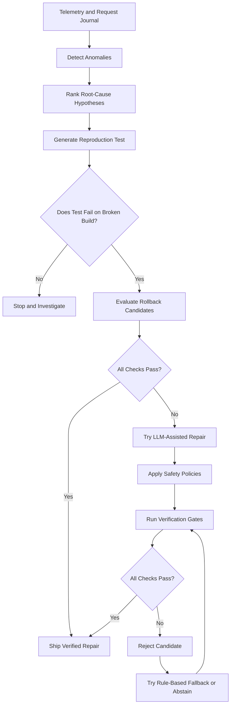

# OpsPilot AI — Verified Production Incident Repair

[](https://github.com/pg7202333-design/OpsPilot/actions/workflows/tests.yml)

**OpsPilot is an AI-assisted incident investigation and repair system that attempts to reproduce failures, evaluate repair candidates, and ship a fix only when verification succeeds.**

Most code-repair workflows focus on generating a plausible patch. OpsPilot focuses on a different question:

**Can we demonstrate that the proposed fix actually works—and reject it when we cannot?**

This is a research and portfolio prototype built around a simulated production service. It explores automated incident investigation, constrained code repair, regression testing, and independent verification.

## Key Features

- **Incident detection:** Analyze simulated telemetry to identify anomalies.
- **Root-cause investigation:** Rank hypotheses using incident evidence.
- **Reproduce before repair:** Generate a test that exposes the original failure.
- **Constrained repair:** Evaluate rollback candidates, rule-based repairs, and optional LLM-generated patches.
- **Multi-stage verification:** Check the reproduction test, existing regression suite, and fresh simulated traffic.
- **Safe fallback:** Reject unsuccessful candidates and use a verified rule-based repair or abstain.
- **Hidden-oracle evaluation:** Compare repaired behavior with the benchmark's healthy implementation on held-out traffic.
- **Automated testing:** Run the test suite locally and through GitHub Actions.

## Architecture



The implementation is organized into two main parts:

- `opspilot/` — detection, investigation, reproduction, repair, sandboxing, verification, and evaluation.
- `shop/` — the simulated application and its services.

See [`docs/architecture.mmd`](docs/architecture.mmd) for the architecture diagram source.

## Verification Strategy

A candidate repair must pass the applicable verification gates before it can be shipped.

1. **Reproduction:** The incident-specific test must fail on the broken build and pass with the candidate repair.
2. **Regression:** Existing tests must continue to pass.
3. **Fresh-traffic validation:** The simulated workload must no longer exhibit the targeted anomaly.
4. **Hidden-oracle evaluation:** Held-out benchmark behavior must match the healthy implementation and satisfy the benchmark's anomaly checks.

A generated patch is not considered successful merely because it looks reasonable or applies cleanly.

## Benchmark and Current Evidence

OpsPilot includes OpsBench, a deterministic simulated shop with six fault families:

- Inventory overselling
- Non-retryable payment retries
- Payment timeout configuration
- Stale catalog cache
- N+1 catalog calls
- Order rounding

The latent benchmark removes the culprit deployment, making simple rollback insufficient to resolve the seeded faults.

In the previously recorded 48-case latent benchmark, the rule-based fallback repaired all 48 cases according to the benchmark's hidden oracle, while the naive latest-deployment rollback baseline repaired none.

These results are **simulated benchmark evidence, not proof of real-world production reliability**. The benchmark contains a limited set of known fault families, and its verification and oracle checks share some assumptions.

The six documented v6 Ollama demos also shipped verified rule-based repairs; the LLM proposals were rejected. These demos should not be represented as six successful LLM-authored fixes.

For the detailed methodology and recorded results, see [`docs/V6_BENCHMARK_RESULTS.md`](docs/V6_BENCHMARK_RESULTS.md).

## Tech Stack

- Python
- Automated testing with `unittest`
- Git and GitHub
- GitHub Actions for continuous integration
- Optional Ollama integration for local LLM-assisted demos

The core test suite uses Python's standard library and requires no package installation.

## Getting Started

### Requirements

- Python 3.10 or newer
- Git
- Optional: [Ollama](https://ollama.com/) with the configured model available for LLM-assisted demos

### Clone the repository

```bash
git clone https://github.com/pg7202333-design/OpsPilot.git
cd OpsPilot
```

### Run the tests

```bash
python3 -m unittest discover -s tests -v
```

Run the service regression tests:

```bash
python3 -m unittest discover -s shop_tests -v
```

Run focused repair-policy tests:

```bash
python3 -m unittest tests.test_rule_repairs -v
```

### Run a sample incident

With Ollama running and the required model installed:

```bash
python3 -m opspilot demo catalog_stale_cache-latent-s1 --ollama
```

Inspect the final summary for `verified: True`, `truly fixed (hidden oracle): True`, and the actual repair source. A successful rule-based repair must not be described as an LLM-authored fix.

### Record a demo run

Run an incident and automatically save its terminal output to a timestamped file under `results/demo/`:

```bash
bash scripts/record_demo.sh inventory_oversell-latent-s1
```

You can record a different incident by passing its ID:

```bash
bash scripts/record_demo.sh catalog_stale_cache-latent-s1
```

Optional CLI flags can be passed after the incident ID, for example `--ollama`. The script saves output locally; generated results are excluded from Git. Review the final report for `verified: True`, `truly fixed (hidden oracle): True`, and the repair source. A rule-based repair is not an LLM-authored fix.

### Reproduce the six v6 latent demos

```bash
python3 -m opspilot demo orders_n_plus_one-latent-s1 --ollama
python3 -m opspilot demo inventory_oversell-latent-s1 --ollama
python3 -m opspilot demo payments_retry_declined-latent-s1 --ollama
python3 -m opspilot demo payments_timeout_config-latent-s1 --ollama
python3 -m opspilot demo catalog_stale_cache-latent-s1 --ollama
python3 -m opspilot demo orders_rounding-latent-s1 --ollama
```

These demos require the configured Ollama model to be available. Their outcomes may depend on the environment and implementation version.

## Repository Structure

```text
opspilot/
  detect.py       # Telemetry anomaly detection
  investigate.py  # Root-cause hypothesis ranking
  reproduce.py    # Incident reproduction tests
  repair.py       # Repair strategies
  llm.py          # LLM integration
  sandbox.py      # Controlled patch execution
  verify.py       # Verification gates
  eval/           # Benchmark runner and metrics

shop/             # Simulated application
tests/            # OpsPilot tests
shop_tests/       # Service regression tests
docs/             # Architecture and benchmark evidence
.github/workflows/
                  # Automated CI workflow
```

## Limitations and Safety

OpsPilot is a prototype, not a production-ready autonomous SRE system.

- The benchmark covers a small set of seeded fault families.
- Simulated success does not establish generalization to unseen production incidents.
- Verification and hidden-oracle checks are not fully independent in their assumptions.
- The patch sandbox is not equivalent to hardened container or operating-system isolation.
- macOS resource limits and other safeguards are best-effort.

Do not run this prototype against production systems, sensitive credentials, or untrusted code without substantially stronger isolation and security controls.

## Roadmap

- Add a reproducibility script that records machine-readable benchmark results.
- Expand evaluation to unseen, concurrent, and multi-file faults.
- Add adversarial verification and mutation testing.
- Strengthen sandbox isolation with network restrictions and a read-only base filesystem.
- Compare rule-only, LLM-only, and full-pipeline approaches on a larger held-out benchmark.
- Publish reproducible evidence with clear metrics and documented limitations.

## Project Links

- [GitHub Repository](https://github.com/pg7202333-design/OpsPilot)
- [Architecture Diagram](docs/architecture.mmd)
- [v6 Benchmark Results](docs/V6_BENCHMARK_RESULTS.md)

---

**Core principle:** A plausible patch is not a proven fix.